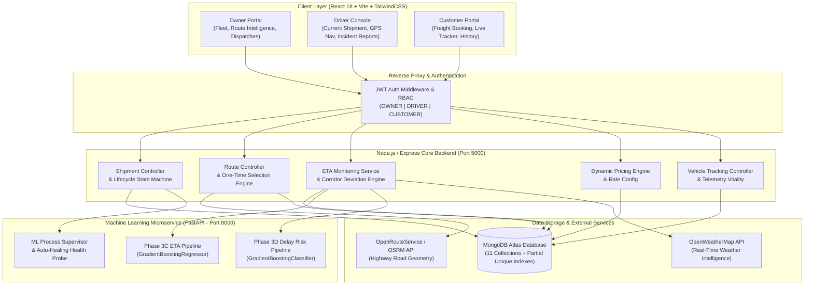

# RouteXAI — AI-Powered Smart Logistics & Route Intelligence Platform

[](https://github.com/omsainandanreddy14/ROUTEXAI-Ai-Logistcs-management-system)
[](https://nodejs.org/)
[](https://react.dev/)
[](https://fastapi.tiangolo.com/)
[](https://www.mongodb.com/)
[](https://tailwindcss.com/)
[](LICENSE)

---

## 1. Project Title & Overview

**RouteXAI** is a full-stack, enterprise-grade AI-powered smart logistics, dynamic freight pricing, fleet dispatch, and real-time route intelligence platform designed for Pan-India freight operations.

Built with a modern reactive architecture, RouteXAI unifies three core stakeholders—**Fleet Owners / Dispatchers**, **Commercial Drivers**, and **Enterprise Customers**—into a single synchronized ecosystem. The platform couples high-resolution OpenStreetMap/OpenRouteService road geometry, machine-learning-driven delivery ETA regression, gradient-boosted delay risk classification, GPS route corridor deviation monitoring, multi-factor freight pricing, and strict shipment lifecycle state machines.

---

## 2. Problem Statement

Freight transport and supply chain management across India face critical operational bottlenecks:
- **Opaque Freight Quoting**: Static pricing models fail to account for road terrain, cargo weight density, hazardous material classifications, and regional highway factors.
- **Inaccurate ETAs & Stale Telemetry**: Conventional logistics trackers rely on straight-line distances or crude highway speed approximations without factoring in weather hazards, traffic congestion, or intermittent GPS blackouts.
- **Uncontrolled Route Deviation**: Vehicles frequently diverge from designated high-security freight corridors without immediate alert triggers or historical deviation logging.
- **Data Desynchronization**: Conflicting records between owner dispatch systems, driver mobile terminals, and customer tracking portals lead to duplicate assignments, inconsistent shipment stages, and manual dispatch chaos.

---

## 3. Proposed Solution

RouteXAI solves these challenges through an integrated three-tier platform:
1. **Dynamic Road-Engine Pricing**: Computes verified driving distances and multi-tier pricing breakdowns (Distance charge + Cargo weight charge + Goods category surcharge + Urgency factors) prior to order booking.
2. **Dual-Model ML Intelligence Microservice**: A standalone Python FastAPI service delivering **Phase 3C ETA Regression** (predicting actual transit duration in minutes) and **Phase 3D Delay Risk Classification** (probabilistic classification of shipment delay risk).
3. **Corridor Deviation & Telemetry Vitality Engine**: Differentiates between `LIVE`, `STALE`, and `OFFLINE` GPS telemetry states, pausing corridor deviation checks when signals drop and preserving historical timestamps.
4. **Idempotent One-Time Route Selection**: Enforces strict MongoDB partial unique indexes guaranteeing at most one active selected route per shipment with atomic route archiving.
5. **Strict Shipment Lifecycle State Machine**: Governs dispatches through audited transitions (`CREATED` → `CONFIRMED` → `VEHICLE_ASSIGNED` → `PICKED_UP` → `IN_TRANSIT` → `AT_DESTINATION` → `OUT_FOR_DELIVERY` → `DELIVERED`), with automated fleet availability synchronization.

---

## 4. Main Features

- **Pan-India Road Geometry Calculation**: Integrates OpenRouteService / OSRM to generate real highway candidate routes, step-by-step turn guidance, and waypoint geometries between any Indian cities/coordinates.
- **Dynamic Multi-Signal Route Scoring**: Scores candidate routes out of 100 based on highway quality, road surface, elevation profile, live weather severity, delay risk probability, and distance efficiency.
- **One-Time Route Selection Guard**: Prevents duplicate route records through schema-level partial unique indexes (`{ shipment: 1 }, { unique: true, partialFilterExpression: { status: 'SELECTED' } }`).
- **Telemetry Vitality Monitoring**: Evaluates GPS age against real-time thresholds:
  - `LIVE`: GPS age ≤ 120s — live corridor deviation checks active.
  - `STALE`: GPS age 120s–300s — deviation checks paused, historical values labeled.
  - `OFFLINE`: GPS age > 300s — offline alert banner displayed, last known ETA frozen.
- **Dynamic Freight Pricing Calculator**: Configurable per-kilometer and per-kilogram base rates with goods category surcharges (Standard, Fragile, Electronics, Perishable) and strict Hazmat automated booking blocks.
- **Role-Based Access Control (RBAC)**: Secure JWT authentication separating `OWNER`, `DRIVER`, and `CUSTOMER` roles across backend controllers, API endpoints, and frontend views.
- **Interactive Leaflet Map Visualizations**: Custom map canvases rendering pickup/delivery markers, planned road corridors, live vehicle GPS positions, and deviation vectors.

---

## 5. Stakeholder Portals & Dashboards

### 👑 Owner Dashboard & Command Center (`/owner/*`)
- **Fleet & Dispatch Overview**: High-level telemetry metrics, active freight dispatches, driver duty status, and vehicle load capacity.
- **Route Intelligence (`/owner/route-intelligence`)**: Calculate candidate routes, inspect elevation/weather profiles, view candidate score breakdowns, and select the final operational corridor.
- **Shipments Management (`/owner/shipments`)**: Assign verified available drivers and vehicles to confirmed shipments with automatic capacity validation.
- **Shipment Lifecycle Oversight (`/owner/shipment-lifecycle`)**: End-to-end visual tracking of lifecycle stages with timestamped audit logs.
- **Live ETA & Deviation Monitoring (`/owner/eta-monitoring`)**: Fleet-wide radar showing on-time performance, delay minutes, and off-corridor vehicles.
- **Fleet Vehicles & Drivers (`/owner/vehicles`, `/owner/drivers`)**: Asset registration, maintenance status toggles, and driver licensing records.

### 🚚 Driver Console (`/driver/*`)
- **Current Assigned Shipment (`/driver/dashboard`, `/driver/current-shipment`)**: Real-time view of active dispatch, pickup address, delivery location, telemetry vitality badge, and dynamic next-action dispatch progression button.
- **Route Navigation View (`/driver/route`)**: Full-screen interactive map displaying assigned highway corridor, driving distance, estimated duration, and turn guidance.
- **Driver Duty Status Toggle**: Fast duty state switching (`AVAILABLE`, `ON_TRIP`, `OFF_DUTY`).
- **Disruption & Incident Reporting (`/driver/report-issue`)**: Submit road hazard alerts (traffic bottlenecks, flooding, accidents) directly to the dispatch center.
- **Trip History (`/driver/trips`)**: Archive of past completed delivery runs.

### 📦 Customer Portal (`/customer/*`)
- **Logistics Dashboard (`/customer/dashboard`)**: Instant tracking search by Tracking ID (e.g. `RTX-806756`), recent orders list, and order status pills.
- **Create Freight Order (`/customer/create-shipment`)**: Interactive booking form featuring browser geolocation pickup detection, map click pickers, dynamic verified freight quote calculation, and category selection.
- **Shipment Tracking (`/customer/track`)**: Public and authenticated real-time shipment milestone tracker showing pickup, transit, and delivery progress.
- **Order History (`/customer/history`)**: Archive of historical dispatches and digital receipts.

---

## 6. System Architecture



---

## 7. Technology Stack

| Domain | Technology | Version / Details |
| :--- | :--- | :--- |
| **Frontend Framework** | React.js with Vite | React 18, Vite 5, React Router v6 |
| **Styling & Icons** | TailwindCSS + Lucide Icons | Responsive Navy/Cyan Theme |
| **Mapping & Geospatial** | Leaflet + React-Leaflet | GeoJSON road geometry, custom markers |
| **Backend Runtime** | Node.js | v18+ LTS / Express.js 4 |
| **Database** | MongoDB Atlas / Local MongoDB | Mongoose 8 with Schema-level Indexes |
| **Machine Learning API** | FastAPI + Uvicorn | Python 3.10+ / Pydantic v2 |
| **ML Frameworks** | Scikit-Learn, Joblib, Pandas, NumPy | GradientBoosting Regression & Classification |
| **Routing & Geo Engine** | OpenRouteService (ORS) / OSRM | Driving-car profiles, waypoint coordinates |
| **Authentication** | JSON Web Tokens (JWT) + BcryptJS | Salt rounds: 10, Role-based guards |

---

## 8. Project Folder Structure

```text
RouteXAI/
├── .env.example                                # Master environment variables template
├── .gitignore                                  # Git exclusion configuration
├── package.json                                # Platform root orchestration scripts
├── requirements.txt                            # Root Python ML dependencies
├── start-all.bat                               # Windows 1-click launcher (FastAPI + Node + Vite)
├── RouteXAI_MongoDB_Project_Report.docx        # Comprehensive academic/project documentation
│
├── backend/                                    # Node.js Express REST Backend
│   ├── .env.example                            # Backend environment template
│   ├── .gitignore                              # Backend-specific ignore rules
│   ├── package.json                            # Backend NPM dependencies
│   ├── server.js                               # Express application entrypoint
│   ├── seed.js                                 # Full MongoDB Atlas data seeder (10 users, 11 collections)
│   ├── clear.js                                # Database collection wipe utility
│   ├── config/
│   │   ├── db.js                               # Mongoose connection manager
│   │   └── pricingConfig.js                    # Dynamic pricing rates & category multipliers
│   ├── controllers/                            # Express business controllers
│   ├── middleware/                             # JWT auth, error handlers, role validators
│   ├── models/                                 # 11 Mongoose Schemas & Indexes
│   ├── routes/                                 # REST API route declarations
│   ├── services/                               # Pricing, Route, ETA, Weather, Lifecycle services
│   └── test_*.js                               # Comprehensive backend automated test suites
│
├── frontend/                                   # React Vite Single Page Application
│   ├── package.json                            # Frontend NPM dependencies
│   ├── vite.config.js                          # Vite bundler configuration & /api proxy
│   ├── tailwind.config.js                      # Tailwind theme customization
│   └── src/
│       ├── App.jsx                             # Route definitions & Role-based guards
│       ├── api/axiosInstance.js                # Intercepted Axios client with JWT injection
│       ├── components/                         # Common UI components, RouteMap, Modals
│       ├── context/AuthContext.jsx             # React AuthContext with sessionStorage isolation
│       ├── pages/
│       │   ├── auth/                           # Login and Register pages
│       │   ├── owner/                          # 14 Owner Command Center pages
│       │   ├── driver/                         # 6 Driver Console pages
│       │   └── customer/                       # 6 Customer Booking & Tracking pages
│       └── data/mockData.js                    # Fallback demonstration datasets
│
├── ml/                                         # Python Machine Learning Microservice
│   ├── requirements.txt                        # Python ML dependencies
│   ├── README.md                               # ML architecture & training documentation
│   ├── data/                                   # Synthetic logistics datasets (10,000 records)
│   ├── models/                                 # Trained Joblib model pipelines & metadata
│   ├── reports/                                # Model evaluation reports & evaluation curves
│   ├── scripts/                                # Dataset generation & model training scripts
│   └── services/
│       └── eta_api.py                          # Unified FastAPI service (/predict/eta, /predict/risk)
│
└── scratch/                                    # Lightweight diagnostic & verification scripts
```

---

## 9. MongoDB Database Architecture

RouteXAI organizes operational data across **11 synchronized collections** in MongoDB Atlas:

| Collection | Schema Model | Purpose | Key Indexes |
| :--- | :--- | :--- | :--- |
| **`users`** | `User.js` | User identity & authentication | `email: 1` (unique) |
| **`customers`** | `Customer.js` | Customer corporate profiles & credit limits | `user: 1` |
| **`drivers`** | `Driver.js` | Driver licensing, experience & duty status | `user: 1`, `licenseNumber: 1` |
| **`vehicles`** | `Vehicle.js` | Fleet trucks, registration & payload capacity | `registrationNumber: 1` |
| **`hubs`** | `Hub.js` | Regional sorting hubs & 2dsphere locations | `code: 1`, `location: "2dsphere"` |
| **`shipments`** | `Shipment.js` | Core freight order dispatches & addresses | `trackingNumber: 1`, `trackingId: 1` |
| **`routes`** | `Route.js` | Calculated candidate & selected road corridors | `{ shipment: 1 }` (unique if `status: 'SELECTED'`) |
| **`vehicletrackings`** | `VehicleTracking.js` | Live GPS telemetry & coordinates | `vehicle: 1`, `location: "2dsphere"` |
| **`shipmentetas`** | `ShipmentETA.js` | Real-time ETA snapshots & deviation state | `shipment: 1` (unique) |
| **`shipmentetahistories`**| `ShipmentETAHistory.js`| Historical timeline of ETA updates | `shipment: 1`, `recordedAt: -1` |
| **`shipmentlifecycles`** | `ShipmentLifecycle.js` | Immutable audit log of status transitions | `shipment: 1`, `timestamp: -1` |

---

## 10. Installation & Setup Instructions

### Prerequisites
- **Node.js**: v18.0.0 or later
- **Python**: v3.10 or later
- **MongoDB**: Local MongoDB instance or free MongoDB Atlas cluster
- **Git**: Installed and configured

### Step 1: Clone the Repository
```bash
git clone https://github.com/omsainandanreddy14/ROUTEXAI-Ai-Logistcs-management-system.git
cd ROUTEXAI-Ai-Logistcs-management-system
```

### Step 2: Environment Configuration
Copy `.env.example` into `backend/.env`:
```bash
cp .env.example backend/.env
```
Edit `backend/.env` with your specific settings:
```env
PORT=5000
NODE_ENV=development
MONGO_URI=mongodb://127.0.0.1:27017/routexai
JWT_SECRET=your_jwt_super_secret_key_change_in_production
ORS_API_KEY=your_openrouteservice_api_key_here
FASTAPI_ETA_URL=http://127.0.0.1:8000/predict/eta
FASTAPI_RISK_URL=http://127.0.0.1:8000/predict/risk
```

---

### Step 3: Python ML Microservice Setup
1. Open a terminal and navigate to the root or `ml/`:
```bash
# (Optional) Create Python virtual environment
python -m venv venv
# On Windows:
venv\Scripts\activate
# On Linux/macOS:
source venv/bin/activate

# Install ML dependencies
pip install -r ml/requirements.txt
```
2. Start the FastAPI microservice:
```bash
python -m uvicorn ml.services.eta_api:app --host 127.0.0.1 --port 8000
```
3. Verify health probe:
```bash
curl http://127.0.0.1:8000/health
```

---

### Step 4: Backend Setup
1. Open a second terminal and navigate to `backend/`:
```bash
cd backend
npm install
```
2. (Optional) Seed demonstration database:
```bash
node seed.js
```
3. Start the Express backend server:
```bash
npm start
# Server runs at http://localhost:5000
```

---

### Step 5: Frontend Setup
1. Open a third terminal and navigate to `frontend/`:
```bash
cd frontend
npm install
```
2. Start Vite development server:
```bash
npm run dev
# Frontend runs at http://localhost:3000 (or http://localhost:5173)
```

---

### ⚡ 1-Click Startup (Windows)
Double-click `start-all.bat` in the project root to automatically launch all 3 microservices simultaneously in separate command windows:
- **FastAPI ML Microservice**: `http://127.0.0.1:8000`
- **Node.js Express Backend**: `http://localhost:5000`
- **React Vite Frontend**: `http://localhost:3000`

---

## 11. Demo Login Credentials

The database seeder (`backend/seed.js`) creates accounts for all 3 roles:

| Role | Email | Password | Primary Portal |
| :--- | :--- | :--- | :--- |
| **Fleet Owner** | `owner@routexai.com` | `RouteXAI@123` | `/owner/dashboard` |
| **Fleet Driver** | `rajesh.driver@routexai.com` | `RouteXAI@123` | `/driver/dashboard` |
| **Customer** | `aarav.retail@example.com` | `RouteXAI@123` | `/customer/dashboard` |

---

## 12. Automated Test Execution

RouteXAI includes comprehensive automated verification suites covering backend lifecycles, route integrity, and state synchronization:

```bash
# Run Assignment Lifecycle Suite (34 automated tests)
node backend/test_shipment_assignment_lifecycle.js

# Run Fleet Status & Vehicle Tracking Sync Tests (6 automated tests)
node backend/test_fleet_status_sync.js

# Run One-Time Route Selection & Constraint Tests (7 automated tests)
node backend/test_onetime_route_selection.js

# Run Stale GPS Telemetry & Deviation Tests (8 automated tests)
node backend/test_stale_gps_deviation_sync.js

# Run Dynamic Freight Pricing Engine Tests (10 automated tests)
node backend/test_dynamic_pricing.js

# Run Shipment Lifecycle Stage Machine Tests (22 automated tests)
node backend/test_shipment_lifecycle.js
```

---

## 13. Machine Learning & Synthetic Dataset Disclaimer

> [!IMPORTANT]
> **Academic & Experimental Disclaimer**:
> The Phase 3C ETA regression model and Phase 3D Delay Risk classification pipeline were trained and validated on a synthetic logistics dataset (`routexai_synthetic_logistics.csv`, 10,000 records) constructed using realistic Indian highway network parameters, weather conditions, and vehicle payload weights.
> 
> While the models exhibit strong statistical convergence on the benchmark test set (GradientBoostingRegressor MAE: 19.96 min; GradientBoostingClassifier ROC-AUC: 0.9704), **these results reflect synthetic simulation and do not constitute real-world production performance claims**. In production deployments, models should be retrained on actual historical telemetry logs from live GPS telematics providers.

---

## 14. Implemented vs. Planned Features

### ✅ Fully Implemented & Verified
- Role-based multi-portal architecture (`OWNER`, `DRIVER`, `CUSTOMER`).
- OpenRouteService driving geometry integration with Leaflet map rendering.
- One-time route selection with schema-enforced partial unique indexes.
- Dynamic road-distance freight pricing with category handling surcharges.
- Telemetry vitality tracking (`LIVE`, `STALE`, `OFFLINE`) with corridor deviation pausing.
- Automated fleet capacity validation preventing vehicle over-allocation.
- Backend automated test suites (87+ verified assertions).
- Multi-tab session isolation via `sessionStorage` token management.

### 🔮 Future Enhancements (Planned)
- WebSocket / Socket.io live streaming of vehicle telemetry coordinates.
- Multi-stop / Multi-drop delivery route optimization (Vehicle Routing Problem - VRP).
- Mobile driver app packaging with React Native / PWA offline caching.
- Automated toll tax calculation integration using NHAI FASTag APIs.
- IoT OBD-II device integration for engine temperature and fuel consumption analytics.

---

## 15. License

This project is licensed under the **ISC License**. Developed as an advanced logistics intelligence demonstration platform.
